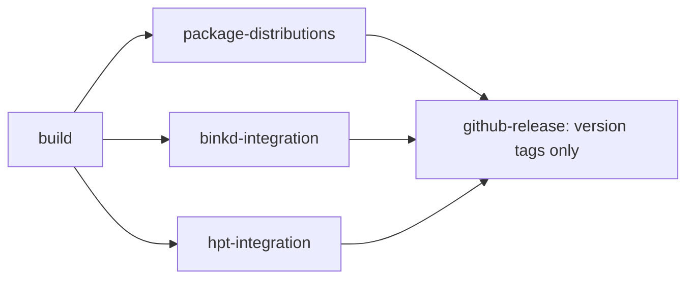

# Standalone distributions

JFtn uses an ordinary classpath distribution, not a fat JAR. Run:

```sh
./gradlew :jftn-bundle:distZip
./gradlew :jftn-bundle:releaseDistributions
```

The first task builds the portable package requiring installed Java 17+. The second
also downloads the locked Temurin OpenJDK JRE 21 LTS archives and produces Linux x64
and Windows x64 packages. Downloads are SHA-256 checked before use. URLs, versions
and hashes are recorded in `gradle/runtime-lock.json`. Runtime binaries are build
outputs and are not stored in Git. Vendor licenses and notices remain in `jre/`.
Other platforms can use the no-JRE ZIP with a matching installed Java runtime.

ZIPs are in `jftn-bundle/build/distributions`. Use `-PreleaseVersion=1.2.3` to set the
archive and JAR version; the default is `1.0-SNAPSHOT`.

```text
jftn-<version>/
  jftn.cmd                Windows command prompt launcher
  jftn.sh                 Linux/macOS launcher
  jftn.ps1                PowerShell launcher
  lib/                    Application, shared libraries and browser UI JARs
    groovy/               Groovy runtime JARs
  plugins/                Database, scheduler, Netty, nodelist and JAM bridge JARs
  scripts/mail-scripts/   Editable AreaFix, FileFix and directory import scripts
  jre/                    Only present in a platform-specific runtime package
  jftn.conf.example       Manual configuration template, never activated automatically
  database/ logs/ lists/ fileecho/
  mail/inbound/ mail/outbound/ mail/tmp/ mail/echo/
  docs/ LICENSE README.txt
```

Launchers set the working directory to the installation root and load `scripts/`,
`lib/*`, `lib/groovy/*` and `plugins/*` as the classpath. They prefer the bundled
JRE, then `JAVA_HOME`, then Java on `PATH`. PowerShell uses the platform's classpath
separator and works on Windows and Unix. Pass `--version` for a version-only check.
The plain application JAR is not self-contained; use a launcher.

Plugins use `ServiceLoader` on this shared classpath; restart to load changed JARs.
There is no hot reload or dependency isolation. Database, scheduler and Netty are
required by the current runner. Nodelist is used by setup/settings lookup. The JAM
bridge can be disabled through its configuration. Do not remove a required module
or its shared dependencies just because its JAR is under `plugins/`.

Mail script resources are excluded from the application JAR and supplied externally.
Existing `MailScript=classpath:mail-scripts/areafix.groovy` settings therefore continue
to work and read the editable file under `scripts/mail-scripts/`.

On first launch, missing working directories are created and the private setup URL
is printed. Completing the wizard creates the live configuration and initial admin.
Configured inbound/outbound/temp/echo paths are created before plugins start on
subsequent launches too. Existing data is never replaced. A regular file occupying
a required directory path is an error, not a reason to overwrite it.

For upgrades, unpack into a new directory and deliberately move/copy your existing
configuration and data after making a backup. ZIP packaging does not migrate or
replace a running installation. See [browser setup](web-ui.md) for account setup.

## CircleCI and GitHub Releases

The main `build` job compiles/tests the application and seals the no-JRE ZIP with
the source revision and SHA-256 checksums. The separate `package-distributions`
job requires `build` and creates the runtime packages from that ZIP using
`-PdistributionInput=<zip>`. No application Java, Thrift or Vue sources are
recompiled in the packaging job. OpenJDK downloads are cached by the runtime lock
checksum; restored archives are verified before use.

Packaging also starts the Linux ZIP using its own launcher and bundled JRE, checks
the embedded browser page and first-run RPC, and verifies missing directories were
recreated. All three ZIPs, `runtime-lock.json` and `SHA256SUMS` are saved as CircleCI
artifacts and passed to the release job through the workspace.



GitHub Actions is not required. To enable publication:

1. Create a CircleCI context named **`github-release`**, restricted to the release
   workflow's trusted maintainers, containing **`GH_TOKEN`**. Use a fine-grained
   GitHub token limited to this repository with **Contents: read and write**.
   Do not put the token in Git, Gradle properties or the archives.
2. Ensure the CircleCI project is triggered by tag pushes. A GitHub App pipeline
   may need its tag-push trigger enabled in project settings; workflow tag filters
   alone do not configure the GitHub event subscription.
3. Push an existing commit with a tag such as `v1.2.3` or `v1.2.3-rc.1`. The tag
   determines `releaseVersion`. Branch builds create snapshot artifacts without
   publishing a GitHub Release.

The `github-release` job requires successful packaging, binkd and HPT integrations.
It verifies artifact hashes and checks that the GitHub tag resolves to the compiled
revision, including annotated tags. It first creates a draft, uploads/validates all
assets, then publishes the complete release with generated notes. Tags containing
a suffix become prereleases. An interrupted upload can resume its own draft;
existing assets with a different hash are never overwritten. Repeating a completed
release succeeds only if its assets match. A conflicting release requires explicit
manual resolution.

The pipeline configuration is supplied in this repository. Creating the context,
granting its token access and enabling the tag event are CircleCI/GitHub account
settings; they cannot be provisioned from this configuration file alone.
