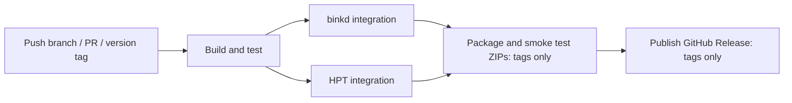

# Standalone distributions

JFtn uses an ordinary classpath distribution, not a fat JAR. Run:

```sh
./gradlew :jftn-bundle:distZip
./gradlew :jftn-bundle:releaseDistributions
```

The first task builds the portable package requiring installed Java 17+. The second
also downloads the locked Temurin OpenJDK JRE 21 LTS archives and produces Linux x64
and Windows x64 packages. Downloads are SHA-256 checked before use. URLs, versions
and hashes are recorded in `gradle/runtime-lock.json`. Runtime binaries are build
outputs and are not stored in Git. Vendor licenses and notices remain in `jre/`.
Other platforms can use the no-JRE ZIP with a matching installed Java runtime.

ZIPs are in `jftn-bundle/build/distributions`. Use `-PreleaseVersion=1.2.3` to set the
archive and JAR version; the default is `1.0-SNAPSHOT`.

```text
jftn-<version>/
  jftn.cmd                Windows command prompt launcher
  jftn.sh                 Linux/macOS launcher
  jftn.ps1                PowerShell launcher
  lib/                    Application, shared libraries and browser UI JARs
    groovy/               Groovy runtime JARs
  plugins/                Database, scheduler, Netty, nodelist and JAM bridge JARs
  scripts/mail-scripts/   Editable AreaFix, FileFix and directory import scripts
  jre/                    Only present in a platform-specific runtime package
  jftn.conf.example       Manual configuration template, never activated automatically
  conf.d/                 Plugin *.conf.example templates; UI never writes active *.conf
  database/ logs/ lists/ fileecho/
  mail/inbound/ mail/outbound/ mail/tmp/ mail/echo/ mail/received/
  docs/ LICENSE README.txt
```

Launchers set the working directory to the installation root and load `scripts/`,
`lib/*`, `lib/groovy/*` and `plugins/*` as the classpath. They prefer the bundled
JRE, then `JAVA_HOME`, then Java on `PATH`. PowerShell uses the platform's classpath
separator and works on Windows and Unix. Pass `--version` for a version-only check.
The plain application JAR is not self-contained; use a launcher.

Plugins use `ServiceLoader` on this shared classpath; restart to load changed JARs.
There is no hot reload or dependency isolation. Database, scheduler and Netty are
required by the current runner. Nodelist is used by setup/settings lookup. The JAM
bridge can be disabled through its configuration. Do not remove a required module
or its shared dependencies just because its JAR is under `plugins/`.

Mail script resources are excluded from the application JAR and supplied externally.
Existing `MailScript=classpath:mail-scripts/areafix.groovy` settings therefore continue
to work and read the editable file under `scripts/mail-scripts/`.

On first launch, missing working directories are created and the private setup URL
is printed. Completing the wizard creates the live configuration and initial admin.
Configured inbound/outbound/temp/echo paths are created before plugins start on
subsequent launches too. Existing data is never replaced. A regular file occupying
a required directory path is an error, not a reason to overwrite it.

For upgrades, unpack into a new directory and deliberately move/copy your existing
configuration, `conf.d/` and data after making a backup. ZIP packaging does not migrate or
replace a running installation. See [browser setup](web-ui.md) for account setup.

## GitHub Actions CI and releases

The `.github/workflows/ci.yml` workflow runs on branch pushes, pull requests and
version tag pushes. Shared scripts live in `ci/`. There is no separate release
build implementation.

The main `build` job runs CI publisher tests and the Gradle build, including Java
formatting checks, Java tests, RPC browser tests and Vue/TypeScript checks/tests.
It seals the no-JRE ZIP and compiled integration runtimes with the source revision
and SHA-256 checksums. A tar preserves permissions and hidden resources when
passing this snapshot to dependent jobs. A portable ZIP is also saved separately
for download on branch/PR builds, with version `1.0-SNAPSHOT`.

Both binkd and HPT integrations run after the build on every supported event.
Only tag pushes additionally run `package` and `publish`. The tag determines the
release version; `ci/build.sh` strictly validates `vMAJOR.MINOR.PATCH` with an
optional prerelease suffix before building.



Both integrations require the main build. Packaging waits for both integrations
to succeed before starting. These jobs verify checksums
and the source revision and use the compiled snapshot without rebuilding Java,
Thrift or Vue sources. Packaging uses `-PdistributionInput=<sealed-no-jre.zip>`.
It smoke tests the bundled Linux launcher, JRE, first-run directories and embedded
UI before saving all three ZIPs, `runtime-lock.json` and `SHA256SUMS`.
Thrift and locked OpenJDK downloads are cached. Intermediate workflow artifacts
and test reports are retained for 15 days; published release assets are separate
from these temporary artifacts.

No personal access token or custom GitHub App is needed.
The publication job uses the automatic `GITHUB_TOKEN` with `contents: write`;
all other jobs have only `contents: read`. Checkout does not persist credentials.
Enable GitHub Actions for this repository and allow the official `actions/*`
actions if organization policy restricts them. Organization policy must also
allow the workflow's requested token permissions.

Push a tag on the commit containing this workflow, for example:

```sh
git tag v1.2.3
git push origin v1.2.3
```

Branch builds do not publish releases. Suffix tags such as `v1.2.3-rc.1` become
prereleases. GitHub tag filters are globs; the build script performs the strict
version validation before any build or publication. Re-running a failed workflow
uses the same tag; concurrency serializes runs for that tag. New branch/PR runs
cancel older runs for the same event/reference; release runs are not cancelled.

Publication requires successful packaging and both binkd/HPT integrations. The
publisher verifies hashes, ZIP names and that the remote GitHub tag resolves to
the compiled revision, including annotated tags. It creates a draft first,
uploads and verifies every asset, then publishes it with generated release notes.
An interrupted upload can resume its own draft. Conflicting assets are never
overwritten; a conflicting release requires manual resolution.

After pushing this migration, stop building the project in CircleCI and remove
unused release contexts/tokens there. If branch protection requires CircleCI
checks, replace them with the GitHub Actions `build` and both `integration`
matrix checks after the first successful run. Repository/organization settings
are not changed automatically by committing workflow files. The workflow does
not publish a release until a matching tag is pushed.

Plugin configuration is separated by service; see [plugin settings](plugin-configuration.md).
Startup creates missing commented `*.conf` files, preserving existing edits.
