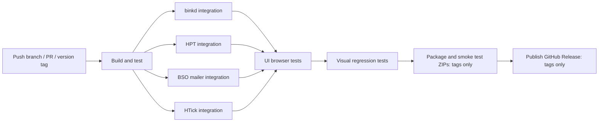

# Standalone distributions

JFtn uses an ordinary classpath distribution, not a fat JAR. Building from source
needs the same Java, Node/npm and Thrift compiler/browser-runtime prerequisites
as the [full build](../README.md#developers); the Full package includes the compiled UI.
Run:

```sh
./gradlew :jftn-bundle:distZipFullNoJre
./gradlew :jftn-bundle:releaseDistributions
```

The first task builds the Full portable package requiring installed Java 17+.
`releaseDistributions` produces **eight ZIPs**: Full, Headless, Legacy and Transit,
each with and without JREs. For example, `distZipLegacyNoJre` and
`distZipLegacyWithJre` build just those variants. See [runtime profiles](transit-profiles.md)
for storage, configuration and recovery rules.

The `with-jre` ZIPs contain both locked Linux x64 and Windows x64 Temurin runtimes
under `jre/linux-x64` and `jre/windows-x64`. Launchers select the appropriate one.
Downloads are SHA-256 checked; URLs, versions and hashes are recorded in
`gradle/runtime-lock.json`. Runtime binaries stay out of Git. Other hosts can use
the no-JRE ZIP with a matching installed Java runtime. A combined runtime archive
is larger than an individual platform runtime package.

ZIPs are in `jftn-bundle/build/distributions`. Use `-PreleaseVersion=1.2.3` to set the
archive and JAR version; the default is `1.0-SNAPSHOT`.

```text
jftn-<version>/
  jftn.cmd                Windows command prompt launcher
  jftn.sh                 Linux/macOS launcher
  jftn.ps1                PowerShell launcher
  lib/                    Application/runtime and shared dependency JARs
    groovy/               Groovy runtime JARs
  plugins/                Optional RPC/UI, database, scheduler, Netty and mail plugins
  scripts/mail-scripts/   Editable AreaFix, FileFix and directory import scripts
  jre/                    Linux x64 and Windows x64 runtimes in with-jre packages
  runtime-profile         Installed profile marker
  jftn.conf.example       Manual configuration template, never activated automatically
  conf.d/                 Plugin *.conf.example templates; UI never writes active *.conf
  database/ logs/ lists/ fileecho/
  mail/inbound/ mail/outbound/ mail/tmp/ mail/echo/ mail/received/
  docs/ LICENSE README.txt
```

Full includes the RPC and Web UI plugins and can start its first-run wizard.
Headless, Legacy and Transit omit those plugins by default and require a manual
`jftn.conf` based on the supplied profile example. Profiles set default package
composition and storage policy; they no longer directly start UI/RPC classes.

The default Log4j2 configuration writes INFO and higher to both the console and
`logs/jftn.log`, rotating the file at 10 MB. It includes binkp connection and
authentication events, completed file transfers, mail-service startup, and tosser
file/packet processing. Netty and MINA2 log binkp commands at INFO with `<<<`
(incoming) / `>>>` (outgoing), connection ID and remote endpoint. PWD passwords
and CRAM responses are redacted;
file blocks are never logged. Remote command text is bounded and control characters
are escaped. File transfers show direction, name, size, resume offset, elapsed
milliseconds and CPS (new bytes per second); successful sending is reported only
after the peer's GOT acknowledgement. Idle inbound scans remain at DEBUG.
The dedicated rotating `logs/binkp.log` contains incoming and outgoing binkp
events too; administrators can read it in **Connections → Binkp log**. Individual
outgoing attempts also retain these safe INFO events in their poll journals.
PKT password mismatches identify the peer and destination without logging
passwords. Exceptions include full stack traces in both outputs.

Launchers set the working directory to the installation root and load `scripts/`,
`lib/*`, `lib/groovy/*` and `plugins/*` as the classpath. They prefer the bundled
JRE, then `JAVA_HOME`, then Java on `PATH`. PowerShell uses the platform's classpath
separator and works on Windows and Unix. Pass `--version` for a version-only check.
The plain application JAR is not self-contained; use a launcher.

Plugins use `ServiceLoader` on this shared classpath; restart to load changed JARs.
There is no hot reload or dependency isolation. Scheduler and Netty are required
by the current runner. SQL profiles also require the database plugin; SQL-free
profiles use filesystem storage instead. Nodelist is used by setup/settings lookup. The JAM
bridge can be disabled through its configuration. Do not remove a required module
or its shared dependencies just because its JAR is under `plugins/`.

In Full, `plugins/rpc-node-VERSION.jar` supplies authenticated TCP/HTTP RPC and
`plugins/web-ui-VERSION.jar` supplies browser resources and initial setup. Stop
the node before changing JARs. Remove only Web UI to keep RPC, or remove both to
keep ordinary mail processing without either service. Disabling
`WebUiEnabled=false` in `conf.d/95-web-ui.conf` keeps RPC but removes browser routes;
`RpcEnabled=false` disables both dependent services. Enabled Web UI requires the
RPC plugin and `RpcHttpEnabled=true`. Without a setup plugin, prepare the main
configuration and RPC credentials explicitly. Installed configuration/accounts
are preserved when a plugin is disabled or removed.

Use matched plugin/dependency versions from the same build. Copying a plugin into
a reduced installation also requires its shared libraries; plugin JARs do not
embed those dependencies. RPC currently requires SQL-backed mail storage and can
be enabled on Full/Headless. Legacy/Transit cannot run it against JAM/file journals.
The `rpc` library in `lib/` provides contracts/transport primitives; its presence
alone does not start an RPC service. See [plugin configuration](plugin-configuration.md).

When upgrading from the older library-based UI layout, replace the managed
application binaries as a consistent set: obsolete `lib/web-ui-*.jar` and
`lib/rpc-node-*.jar` must not coexist with the new plugin copies. The launchers
include both directories, so stale JARs can still supply classes/routes after a
plugin is removed. Prefer a clean binary installation with backed-up operational
state/configuration restored, or explicitly reconcile old managed JARs. Preserve
custom plugins, editable scripts, active conf.d files, accounts and mail; merely
overlaying ZIPs does not remove obsolete files.

Mail script resources are excluded from the application JAR and supplied externally.
Default `MailScript` entries load the external files from
`./scripts/mail-scripts/`, in AreaFix/FileFix/directory-import order. Existing
`classpath:` settings remain supported, but are not used by the defaults.

On first launch, missing working directories are created and the private setup URL
is printed. Completing the wizard creates the live configuration and initial admin.
Configured inbound/outbound/temp/echo paths are created before plugins start on
subsequent launches too. Existing data is never replaced. A regular file occupying
a required directory path is an error, not a reason to overwrite it.

For upgrades, unpack into a new directory and deliberately move/copy your existing
configuration, `conf.d/` and data after making a backup. ZIP packaging does not migrate or
replace a running installation. See [browser setup](web-ui.md) for account setup.

## GitHub Actions CI and releases

The `.github/workflows/ci.yml` workflow runs on branch pushes, pull requests and
version tag pushes. Shared scripts live in `ci/`. There is no separate release
build implementation.

The main `build` job runs CI publisher tests and the Gradle build, including Java
formatting checks, Java tests, RPC browser tests and Vue/TypeScript checks/tests.
It seals the no-JRE ZIP and compiled integration runtimes with the source revision
and SHA-256 checksums. A tar preserves permissions and hidden resources when
passing this snapshot to dependent jobs. A portable ZIP is also saved separately
for download on branch/PR builds, with version `1.0-SNAPSHOT`.
The `storybook` artifact contains the interactive component catalogue and HTTP
viewing instructions. `vrt-baselines` contains every committed expected PNG in
its desktop/mobile directories, independently of whether VRT finds a mismatch.
See [viewing UI artifacts](web-ui.md#component-catalogue).

The binkd, HPT, BSO and HTick integrations run after the build on every supported event.
After all integration suites pass, the `ui` job runs functional component and
real HTTP browser tests. Only after UI tests succeed does the separate `vrt` job
compare visual baselines against the build's compiled Storybook artifact in the
pinned container; see [UI tests](web-ui.md#browser-tests).
Only tag pushes additionally run `package` and `publish`. The tag determines the
release version; `ci/build.sh` strictly validates `vMAJOR.MINOR.PATCH` with an
optional prerelease suffix before building.



Integrations, VRT and functional UI checks must all succeed before packaging.
The integration and UI jobs verify the compiled snapshot's checksums and source
revision. VRT downloads the Storybook artifact from the same workflow run and
installs browser test dependencies inside its container. No downstream test job
rebuilds Java, Thrift or Vue application sources. Packaging uses `-PdistributionInput=<sealed-no-jre.zip>`.
It smoke tests the bundled Linux launcher, JRE, first-run directories and embedded
UI before saving all eight profile ZIPs, `runtime-lock.json` and `SHA256SUMS`.
Thrift and locked OpenJDK downloads are cached. Intermediate workflow artifacts
and test reports are retained for 15 days; published release assets are separate
from these temporary artifacts.

No personal access token or custom GitHub App is needed.
The publication job uses the automatic `GITHUB_TOKEN` with `contents: write`;
all other jobs have only `contents: read`. Checkout does not persist credentials.
Enable GitHub Actions for this repository and allow the official `actions/*`
actions if organization policy restricts them. Organization policy must also
allow the workflow's requested token permissions.

Push a tag on the commit containing this workflow, for example:

```sh
git tag v1.2.3
git push origin v1.2.3
```

Branch builds do not publish releases. Suffix tags such as `v1.2.3-rc.1` become
prereleases. GitHub tag filters are globs; the build script performs the strict
version validation before any build or publication. Re-running a failed workflow
uses the same tag; concurrency serializes runs for that tag. New branch/PR runs
cancel older runs for the same event/reference; release runs are not cancelled.

Publication requires successful packaging, all four integration suites, VRT and UI checks. The
publisher verifies hashes, ZIP names and that the remote GitHub tag resolves to
the compiled revision, including annotated tags. It creates a draft first,
uploads and verifies every asset, then publishes it with generated release notes.
An interrupted upload can resume its own draft. Conflicting assets are never
overwritten; a conflicting release requires manual resolution.

Configure branch protection to require the GitHub Actions `build`, all four
`integration` matrix checks, `vrt` and `ui`. Repository/organization settings are not
changed automatically by committing workflow files. The workflow does not publish
a release until a matching tag is pushed.

Plugin configuration is separated by service; see [plugin settings](plugin-configuration.md).
Startup creates missing `*.conf` files, preserving existing edits. The script
list is active by default; peer/area/feed examples remain commented.

Offline rule validation/import is available through `--check-robot-access` and
`--import-robot-access`; see [robot access](robot-access.md). These commands start
no listeners or first-run setup wizard.
